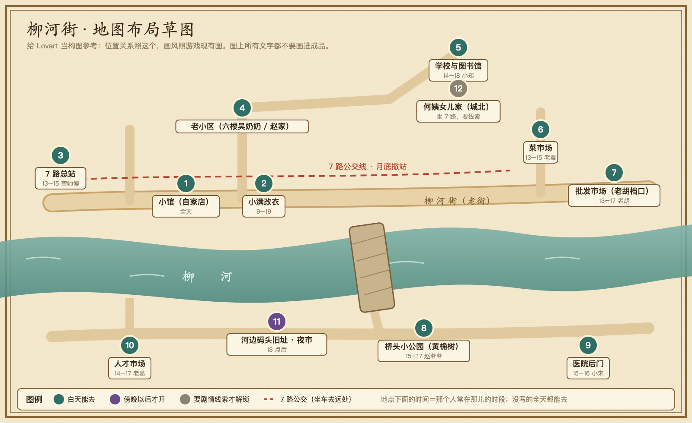
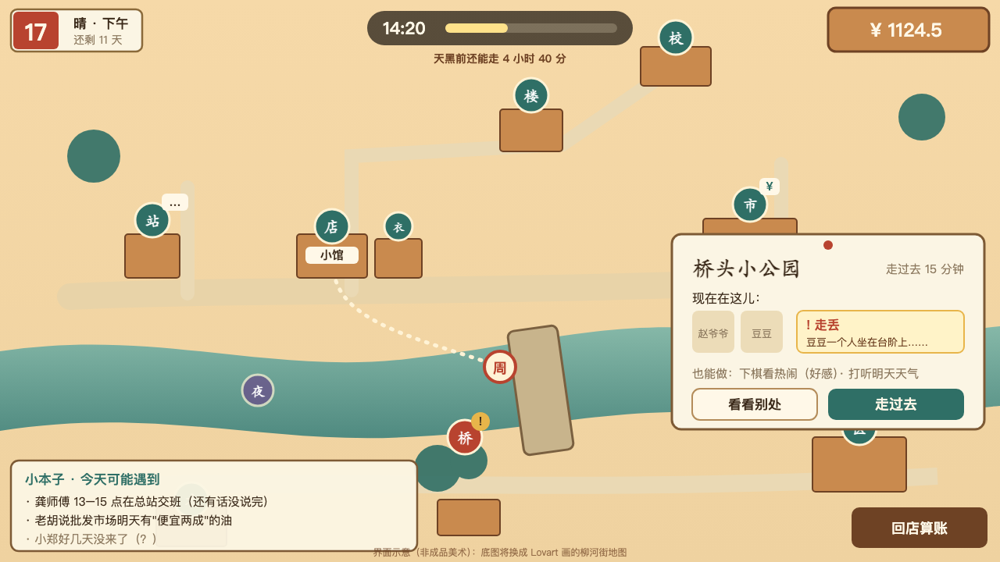

# 《不烧心小馆》自由地图设计与提示词

2026-11-26 · 给组员、给 Gemini、给 Lovart 用。

## 一、先说剧本

- 桌面上这份《完整剧情剧本》和上次发来的是同一份（16,768 字，一字不差），上次列的几处矛盾还在：结尾"贵五毛"和路线不符、老葛工龄两个数、小宋"出院六个病人"写了两遍、视频分在两天、糖油果子和早餐车没收尾、押金差五十块靠老葛刚好还钱救场。
- 它的事件游戏里九成已经有了。Gemini 是照着游戏文字写的，所以这份更像"最好那条路线的通关记录"。它真正新增的是把事件排成了一条按天走的线。
- 自由地图做出来以后，剧情不再按"第几天"固定，而是按"在哪儿、什么时候、满足什么条件"发生。所以建议：**先让 Gemini 按第六部分的格式把剧情补齐，我再一次性做进游戏**，免得在旧结构上改一遍、换地图又改一遍。

## 二、自由地图怎么玩

**一天的流程**：清晨备料 → 早市（店里，玩法不变）→ **午后到傍晚自由走动** → 天黑回店算账。

- **时间**：13:00 出门，19:00 前回店。18 点以后河边夜市才开。走路按远近花 10–30 分钟；看一场戏花 30–60 分钟；干点活（验货、帮人搬东西）花 1 小时。一个下午大概能去 3–4 个地方，去不完，要挑。
- **人有作息**：每个人每天在自己的地方。龚师傅 13–15 点在总站交班，赵爷爷 15–17 点在桥头下棋，小宋下了夜班睡到下午，15 点后在医院后门花坛。下雨、周末、剧情进展会改变他们在哪。
- **地图上的标记**：
  - **!** 这里有剧情。
  - **…** 有熟人在，能聊几句、涨点好感。
  - **¥** 有生意可做：验货、接包餐、收二手灶具。
- **小本子"今天可能遇到"**：把听来的消息列出来。比如"龚师傅说 7 路要调线，下午在总站"，"老胡说明天有便宜两成的油"。玩家照着线索决定走哪条路。
- **错过也算数**：大部分剧情有"错过"的结果。你没去，事情照样发生，第二天早市上会有人提一句，后果也照样落下来。这比"必须在第 X 天看第 X 场戏"更像一条真的街。

## 三、剧情从"第几天"改成"在哪儿、什么时候、满足什么"

剧情分三种：

**1. 日历节点（固定日子，只留最少的几个）**
第 7、14、21 天交房租，第 26 天续租，第 27 天末班车，第 28 天写招牌。这几场在店里自动发生，不管玩家下午去了哪。

**2. 压力事件（在一段日子里，条件满足就会找上门）**
涨价、无票羊肉、检查、视频、停电、并线通知、老胡最后一次上门……它们有时间窗，先后顺序会因为玩家的经营方式不同而不同。比如油总是旧的，检查会提前来；小郑好感高，视频会早几天发。

**3. 人物线（每人 6–10 段，放在具体地点）**
每段写清楚：在哪、哪几天能发生、几点、要什么条件、错过会怎样。以赵爷爷为例：

| 段 | 地点 | 可发生的日子 | 时段 | 条件 | 错过会怎样 |
|---|---|---|---|---|---|
| 树底下的棋 | 桥头小公园 | 第 3–10 天 | 15–17 | 好感 ≥ 2 | 无事 |
| 作业本 | 店里（傍晚他来取） | 落下作业本后第 1–3 天 | 18 点后 | 早市上他把作业本落下了 | 豆豆第二天早上哭着来要 |
| 回家的路 | 桥头小公园 | 第 12–17 天 | 15–17 | 好感 ≥ 5 | 第二天龚师傅说"老赵昨天在菜市场转了一下午" |
| 走丢 | 菜市场 | 回家的路之后 2–4 天 | 16–18 | — | 豆豆一个人来早市，玩家不知道发生了什么 |
| 老样子卡片 | 店里 | 走丢之后 | 早市 | — | — |

**新增一条线：何姨**。现在何姨只活在一张条子里。建议让线索一点点攒起来：何姨的条子、老秦的旧借条、龚师傅说她当年修路时去桥头卖粥、王阿姨吃了十一年她的粥。攒够了，地图上解锁 **12 号"何姨女儿家"**，要坐 7 路去、花一整个下午。见到她以后，她最后一天会不会回来看一眼，可以成为结局的一部分。

## 四、地点清单（12 处）

| 编号 | 地点 | 谁常在（时段） | 能做的事 | 要画的图 |
|---|---|---|---|---|
| 1 | 不烧心小馆（自家店） | — | 练手、试新菜、等人上门 | 已有 |
| 2 | 小满改衣（隔壁） | 小满、糖糖（9–19） | 串门、钉扣子、学糖油果子 | 新：铺子里面 |
| 3 | 7 路总站 | 龚师傅（13–15） | 接包餐、听线路消息 | 新：调度室门口 |
| 4 | 老小区（六楼吴奶奶、赵家） | 阿力（送餐时）、豆豆（放学后） | 送粥上楼、帮吴奶奶 | 新：楼道和六楼门口 |
| 5 | 学校与图书馆 | 小郑（14–18）、豆豆（放学） | 看小郑的论文、接豆豆 | 新：图书馆门口 |
| 6 | 菜市场 | 老秦（13–15）、王阿姨 | 买菜、看老胡怎么挤老秦 | 新 |
| 7 | 批发市场（老胡档口） | 老胡（13–17） | 验货、谈价、拒绝或接受便宜货 | 新 |
| 8 | 桥头小公园（黄桷树） | 赵爷爷（15–17）、下棋的老头 | 下棋、打听明天天气 | 新（现在用的是街景图） |
| 9 | 医院后门 | 小宋（15–16） | 听出院病人的事、吴奶奶住院 | 新 |
| 10 | 人才市场 | 老葛（14–17） | 撞见老葛、帮他填表 | 新 |
| 11 | 河边码头旧址 · 夜市（18 点后） | 龚师傅、街坊 | 听老街的往事、夜里卖宵夜（经营选项） | 新：傍晚和夜里两张 |
| 12 | 何姨女儿家（城北，坐 7 路） | 何姨 | 何姨线 | 新，攒够线索才解锁 |

## 五、设计图

下面两张都是示意，不是成品美术。第一张给 Lovart 当构图参考，第二张说明界面怎么摆。





## 六、给 Lovart 的提示词

### 6.1 先说用法

1. **每次都上传风格参考图**：`assets/shop.png`（店门口）、`assets/runtime/bg/bg_street.jpg`（桥头街景）、`assets/runtime/bg/bg_room_main.jpg`（店里）。人物图再加 `不烧心小馆_Claude美术资产包_v1/10_生产可用/角色/orig_regulars_group.png`。
2. **画大地图时**，再上传上面的"柳河街布局草图"当构图参考。
3. **任何图里都不要出现文字**，招牌、标签、店名都由游戏程序写上去。
4. **尺寸**：场景背景 16:9，出 2K（2560×1440），我再缩成 1280×720；人物 1:1，透明背景；大地图 16:9 出 2K。
5. **命名和存放**：放进 `不烧心小馆_Claude美术资产包_v1/12_自由地图/`，文件名用下面每条标题后的英文名，方便我对号入座。

### 6.2 每条都要加的风格句

> 16-bit 像素风插画，中国西南临河老城的市井生活，温暖的琥珀色晨光或午后光，青绿色和赭石色点缀，柔和的抖动阴影，细节丰富但不杂乱，温馨怀旧，和参考图同一个画师的风格。画面中不要出现任何文字、字母、数字、水印、UI 界面元素。

### 6.3 大地图（map_liuhe）

> 柳河街全景地图，45 度俯视的像素风小镇插画，宽画幅 16:9。一条青绿色的河从左到右横穿画面中下部，河上一座石拱桥。北岸是一条老街，青瓦木楼、店铺挨着店铺，街中间有一家很小的早餐铺，门头招牌是空白的木板。老街西头是公交总站，有两辆绿色老式公交车和一间小调度室；北边是一片老居民楼、一所学校和图书馆；东头是菜市场和一个热闹的批发市场，停着白色厢式货车。南岸有一个带大黄桷树的小公园、一家医院的后门和花坛、一栋写字楼前的空地（人才市场），河边有一段废弃码头的石阶。午后阳光，路上有零星行人、自行车、三轮车。构图参考上传的布局草图。+ 风格句

### 6.4 场景背景（各 1280×720，侧视，和店里那张同样的视角）

- **bg_tailor 小满改衣铺**：十平米的裁缝铺里，一台老式缝纫机靠着窗，墙上挂满待改的衣服和皮尺，案板上散着布料和划粉。后窗开着一条缝，窗台上一盆绿萝。里屋门帘半掀，能看见一张小书桌。午后的光从窗子斜进来。+ 风格句
- **bg_depot 7 路总站**：公交总站的调度室门口，一排绿色老式公交车停在雨棚下，调度室小窗口，门边一张掉漆的木长凳，墙上贴着线路图（不要文字）。午后。+ 风格句
- **bg_lane 老小区楼道**：九十年代的六层老居民楼，没有电梯，楼梯间斑驳的墙、楼道里的自行车和花盆，一扇贴着褪色福字的旧防盗门（不要文字）。下午的光从楼梯间的窗户照进来。+ 风格句
- **bg_school 学校与图书馆门口**：一所小学门口和旁边的老图书馆，铁门、梧桐树、门口停着几辆自行车，放学时有背书包的孩子。+ 风格句
- **bg_veg 菜市场**：露天菜市场的一角，竹筐里堆着青菜、小葱、老南瓜，一辆旧三轮车停在摊位边，摊主的草帽挂在车把上，远处一辆白色货车挡住了路口。+ 风格句
- **bg_whole 批发市场**：批发市场里一个大档口，成箱的冻品和大桶的油码得很高，一辆白色厢式货车正在卸货，地上有水渍，灯光有点冷。气氛热闹又有点乱。+ 风格句
- **bg_park 桥头小公园**：河边的小公园，一棵巨大的黄桷树下摆着石桌石凳，石桌上有一盘象棋，远处是石拱桥和河面，柳枝垂到水里。午后。+ 风格句
- **bg_hospital 医院后门**：一家老医院的后门，门口一个圆形花坛，几张长椅，墙上挂着空白的指示牌，一辆电动车停在旁边。阴天的下午，光线柔和偏冷。+ 风格句
- **bg_talent 人才市场门口**：一栋旧写字楼前的空地，门口一排公告栏贴满纸张（纸上不要字），树荫下几张长椅，几个穿衬衫的中年人在看公告。午后。+ 风格句
- **bg_wharf_dusk 河边码头旧址（傍晚）**：河边一段废弃的码头石阶，石阶伸进水里，岸边一排旧木桩，远处老街的灯一盏盏亮起来，天空是橙紫色的黄昏。+ 风格句
- **bg_wharf_night 河边夜市（夜里）**：同一个码头，夜里河边摆起几个小吃摊，挂着暖黄色的灯泡串，冒着热气，人影三三两两，河面倒映着灯光。+ 风格句
- **bg_heyi 何姨女儿家（城北）**：城北一个安静的老式小院，晾衣绳上晒着小孩的衣服，墙角一个煤炉和一口旧铁锅，窗台上一摞旧本子。傍晚，暖色。+ 风格句

每张场景如果要分时段，再出一张"同一构图，黄昏光线"的版本（文件名后加 _dusk）。

### 6.5 地图上的小元素（透明背景）

- **map_pins 地点图钉一套**：12 个圆形像素图标，每个里面画一个能代表这个地方的小东西：早餐碗、缝纫机、公交车、楼房、书本、青菜、货箱、黄桷树、红十字、公告栏、灯笼、小院门。统一描边和配色。
- **map_zhou 老周的地图小人**：Q 版像素小人，戴白头巾、系青绿色围裙的中年男人，四个方向各四帧走路动画，排成一张精灵图。
- **map_marks 事件标记**：感叹号、省略号气泡、铜钱三种小标记，各一个，像素风。

### 6.6 新人物（全身立绘，1:1，透明背景，和现有八位常客同一套画法）

- **spr_heyi 何姨**：六十多岁的女人，花白短发，旧围裙，手上有老茧，眼神凶但嘴角带点笑，手里拿着一本卷边的本子。
- **spr_landlord 房东汪姐**：五十多岁，烫过的短卷发，腰上挂着一大串钥匙，拎着皮包，精明利落。
- **spr_hu 批发商老胡**：四十多岁，微胖，夹克敞着怀，叼着烟，笑容热络，手里拿着一叠单据。
- **spr_wu 吴奶奶**：八十岁，瘦小，开衫毛衣，拄着拐杖，牙不太好，笑起来很慈祥。
- **spr_tangtang 糖糖**：八九岁的小女孩，扎马尾，背着书包，围着一条小围巾，有点瘦弱。
- **spr_doudou 豆豆（单人）**：八九岁的男孩，戴红领巾，背大书包，门牙缺了两颗。
- **spr_wang 王阿姨**：六十岁，提着两个大蛇皮袋，穿碎花外套，要出远门的样子。
- **spr_peer 早餐车老板**：二十多岁精瘦的年轻人，红色围裙，推着一辆电动早餐车。
- **spr_inspector 检查员小陈**：二十多岁，穿深蓝色制服，拿着记录夹，认真但不凶。

## 七、给 Gemini 的补充需求（整段复制）

```
上一版剧本写得很好，事件之间的因果和人物交集都比之前清楚。现在游戏要改成"自由地图"：玩家每天上午在店里做早市，下午可以在柳河街上自由走动，自己决定去哪。剧情不再按"第几天"固定，而是按"在哪儿、什么时候、满足什么条件"发生；错过的事照样会发生，只是玩家没在场。请按下面的要求重写和补充。

一、先修正上一版的问题
1. 结尾"贵五毛，街上的人认了这五毛"和这条路线不符（老周第 9、10 天都没动价）。
2. 老葛的工龄统一成一个数。
3. 小宋"出院六个胃病病人"在第 11 天和第 16 天重复了。
4. 视频统一在一天爆发。
5. 第 13 天小满要教炸糖油果子、第 10 天对面开了早餐车，这两条在后面都要有下文。
6. 押金差五十块、老葛刚好来还钱，太巧。请改成：第 25 天前后老胡最后一次上门，开出最诱人的条件（便宜的散装油或没票的货），这是全剧对"不烧心"最重的一次考验；老周拒绝以后，要自己付出代价来凑押金（比如每样涨五毛，赌街坊认不认）。老葛还钱放在押金解决之后。

二、地点（共 12 处，请为每处写一段 100 字左右的描写，以及白天谁常在、几点在）
1 不烧心小馆（自家店）　2 小满改衣（隔壁）　3 7 路总站　4 老小区（六楼吴奶奶家、赵家）　5 学校与图书馆　6 菜市场　7 批发市场（老胡档口）　8 桥头小公园（黄桷树）　9 医院后门　10 人才市场　11 河边码头旧址 · 夜市（18 点后才开）　12 何姨女儿家（城北，坐 7 路去，攒够线索才解锁）

三、剧情分三种，请分别写
1. 日历节点（只有这几个，固定日子，在店里发生）：第 7、14、21 天交房租，第 26 天续租，第 27 天 7 路末班车，第 28 天写招牌。
2. 压力事件（有时间窗，条件满足就找上门）：涨价、无票羊肉、检查、视频、早餐车价格战、停电、并线通知、老胡最后一次上门。每个写清楚：最早和最晚可能发生在第几天、什么条件会让它提前或推迟（比如油总是旧的，检查会提前来）、发生在哪、选择和代价。
3. 人物线：八位常客各 6–10 段，另外新增一条"何姨线"（线索从条子、老秦的借条、龚师傅讲她去桥头卖粥、王阿姨吃了十一年她的粥里一点点攒起来，攒够了去城北见她）。每段放在一个具体地点。

四、每一段剧情都用下面这张表的格式交（一段一行，对白另起）
| 编号 | 名称 | 地点 | 可发生的日子 | 时段 | 出场人物 | 条件（好感、前一段是否看过、经营方式等） | 错过会怎样 |
表下面写这一段的对白：每句写成"人名：台词"，老周心里的话写成"（老周心里）……"。有选择的地方写【选择】，每个选项写"选项名（看得见的代价）→ 后果"。

五、日常小事：每个地点写 4–6 个"随机小事"（没有大剧情时遇到的），每个 2–4 句，让这条街平时也有人气。

六、结局：6–8 个，每个说明是怎么从选择、经营方式和"去没去见谁"里长出来的，招牌上写什么字（不超过 6 个字），每位常客和何姨最后怎么样。

七、写作和字数要求
- 每个人说话的口气要不一样（沿用上一版的人设）；街坊说带一点川渝味的普通话，点到为止。
- 不说教，不写金句，不用"不是……而是……"和三连排比，没人说"做生意要讲良心"这类话。
- 对白和心里话每句不超过 40 字；选项名不超过 9 字，括号里的代价不超过 12 字。
- 不出现真实品牌、真实地名、真实人名；"烧心"不是医学诊断；冻品、散装油不等于违法有毒。

内容多，请分批交：
第一批：修正说明 + 12 个地点描写 + 日历节点 + 压力事件；
第二批：赵爷爷、小宋、老葛、阿力四条人物线；
第三批：龚师傅、小满、小郑、老秦、何姨五条人物线；
第四批：各地点的日常小事 + 结局。
每批开头先列出你这批写了哪些编号，方便我核对。
```

## 八、接下来

- **我这边**：地图系统可以先做，用现在的街景图和这张布局草图占位。包括地图、时间、作息、标记、小本子线索、错过机制。等 Lovart 的图和 Gemini 的稿子到了，再换图、填剧情。
- **你们那边**：Lovart 按第六部分出图，放进 `12_自由地图/` 文件夹；Gemini 按第七部分分四批交稿，交回来的稿子发我。
- 现有的音效和配音方案，等剧本定稿后再做。
